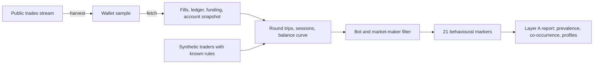
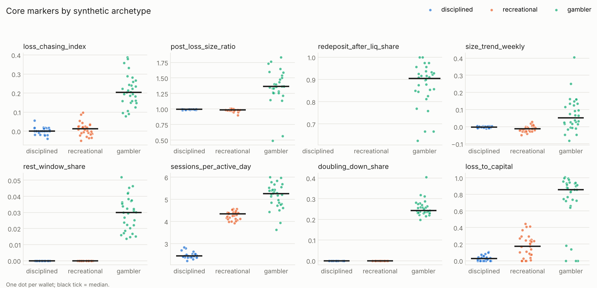

# hyperbehave

[](https://github.com/YKasra/hyperbehave/actions/workflows/ci.yml)
[](LICENSE)

**Gambling-like behavioural signatures in on-chain perpetual futures trading.**

Recent studies find that problematic cryptocurrency and day trading overlap strongly
with gambling disorder: chasing losses, escalating stakes, trading through the night,
continuing despite financial harm. Almost all of that evidence comes from
questionnaires. This project asks what the same patterns look like in **actual trading
behaviour**, using the fully public trade history of the Hyperliquid perpetual futures
exchange.

It turns raw fills into 21 behavioural markers, each mapped to a DSM-5
gambling-disorder criterion, and validates every marker on synthetic traders whose
behaviour is known before touching real data.

> Status: pilot (v0.2). Pipeline, markers, tests and synthetic validation are done, and the
> first run on real wallets is complete; v0.2 fixes three issues it surfaced.
> Next: a larger real-wallet sample. See [docs/roadmap.md](docs/roadmap.md).

## Research questions

1. How common are gambling-like trading patterns among active Hyperliquid wallets?
2. Do these patterns co-occur, the way symptoms of a disorder do, or appear in isolation?
3. Are they associated with financial harm (losses relative to deposits, drawdowns, liquidations)?

This is a descriptive study of public data. It does not diagnose anyone. A planned
follow-up (Layer B) links consenting traders' wallets to validated questionnaires
such as the Trading Disorder Scale; see [docs/ethics.md](docs/ethics.md).

## How it works



**Round trip** (one position from open to flat) is the unit of a bet. The **balance
curve** is rebuilt backwards from the live account value, which turns position size
into effective leverage; wallets whose public money flows do not add up are flagged and
their balance-based markers discarded. Time-use markers (sessions, rest window) count
only the trader's own **taker orders**, one per order, so resting limit orders that fill
overnight and one order sweeping several price levels are not mistaken for activity.
Wallets are identified by a salted hash from the moment data leaves the raw layer.

## Core markers

| Marker | DSM-5 criterion | Definition |
| --- | --- | --- |
| `loss_chasing_index` | Chasing losses | P(new position within 60 min after a loss) minus the same after a gain |
| `post_loss_size_ratio` | Chasing losses | Size of the next position after a loss / after a gain |
| `redeposit_after_liq_share` | Chasing, loss of control | Share of liquidations followed by new money within 24 h |
| `size_trend_weekly` | Tolerance | Weekly slope of log position size |
| `rest_window_share` | Loss of control | Share of opening trades inside the wallet's own quietest 5 h window (sleep proxy) |
| `sessions_per_active_day` | Preoccupation | Trading sessions per active day |
| `doubling_down_share` | Chasing losses | Share of positions increased while under water |
| `loss_to_capital` | Harm | Net loss in the window / capital at risk (balance at window start + money added) |

All 21 markers, their definitions and known limitations:
[docs/feature_dictionary.md](docs/feature_dictionary.md).

## Synthetic validation

Before any real data, each marker must recover a behaviour we programmed. The synthetic
generator writes wallets in the exact API format for four archetypes: *disciplined*,
*recreational*, a *gambler* (martingale sizing, fast re-entry after losses, adds to
losers, trades through its rest hours after losses, re-deposits after liquidation) and
a market-making *bot*.



All 5 bots are removed by the exclusion rules and no human wallet is lost. Thirteen
markers separate the programmed gambler with AUC above 0.8. The report also lists the
markers the simulation **cannot** test (for example reaction to market shocks, which was
never programmed), so a high or low AUC there is not read as evidence. Full table:
[reports/synthetic_validation](reports/synthetic_validation/README.md).

## Quickstart

```bash
git clone https://github.com/YKasra/hyperbehave
cd hyperbehave
pip install -e ".[dev]"

# 1. Offline: run the synthetic validation (no internet needed)
hyperbehave validate

# 2. Collect active wallets from the public trades stream (free)
hyperbehave harvest --minutes 60

# 3. Download 90 days of data for a random 500 wallets (free; Ctrl+C safe with --resume)
hyperbehave fetch --sample 500 --days 90 --resume

# 4. Market candles for the volatility marker
hyperbehave candles --coin BTC --days 90

# 5. Markers for every wallet, then the population report
hyperbehave features
hyperbehave describe

# Optional: counts of event types in your raw data (no addresses), to check parsing
hyperbehave inspect
```

Every threshold lives in `src/hyperbehave/default_config.yaml`. Override any subset
with `hyperbehave --config my_settings.yaml ...` for sensitivity analyses.

### Cost

The free path above uses only the public API. For complete histories beyond the
API's 10,000-fill cap, the S3 node archive is available at AWS transfer cost (a few
dollars per month of data). Run `hyperbehave s3-size` first. Details:
[docs/data_sources.md](docs/data_sources.md).

## Repository layout

```text
src/hyperbehave/
  ingest/          API client (paginated, throttled), trades-stream harvester, S3 reader
  normalize.py     typed tables from raw API records
  reconstruct.py   round trips, sessions, balance curve, effective leverage
  filters.py       bot and market-maker exclusion rules
  markers.py       the 21 markers and their DSM-5 mapping (single source of truth)
  features.py      one row of markers per wallet
  synthetic.py     agent-based synthetic traders in API format
  analysis.py      prevalence screen, co-occurrence, AUC, behavioural profiles
  report.py        Markdown and figure reports
  cli.py           command line entry point
docs/              feature dictionary, data sources, ethics, roadmap
reports/           generated reports (synthetic only in the public repo)
tests/             pytest suite, runs offline
```

## Ethics and privacy

Raw data stays on your machine (`data/` is git-ignored). Derived tables use salted
pseudonyms. Published outputs are aggregates only; no wallet addresses or wallet-level
scores are ever released. See [docs/ethics.md](docs/ethics.md).

## Citation

If you use this code, please cite it via [CITATION.cff](CITATION.cff).

## Author

Kasra Yaraei, MSc Computer Science for Business Administration (Romanian-American
University, Bucharest). Part of a planned PhD on problematic trading as a behavioural
addiction.

## License

MIT
