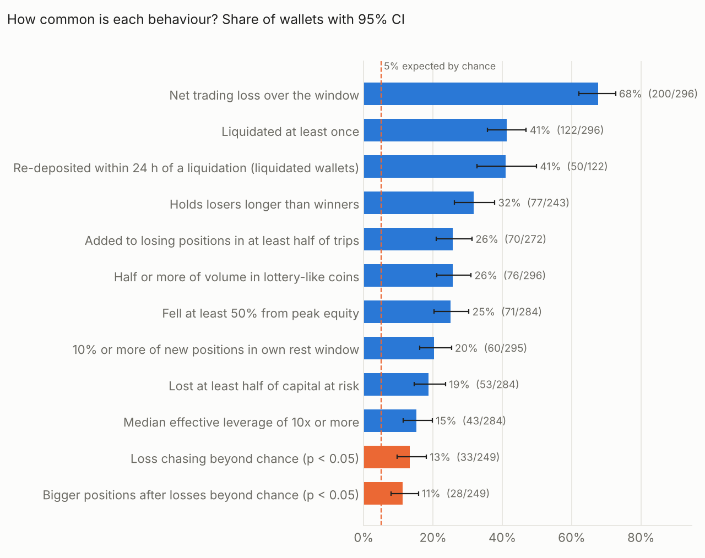
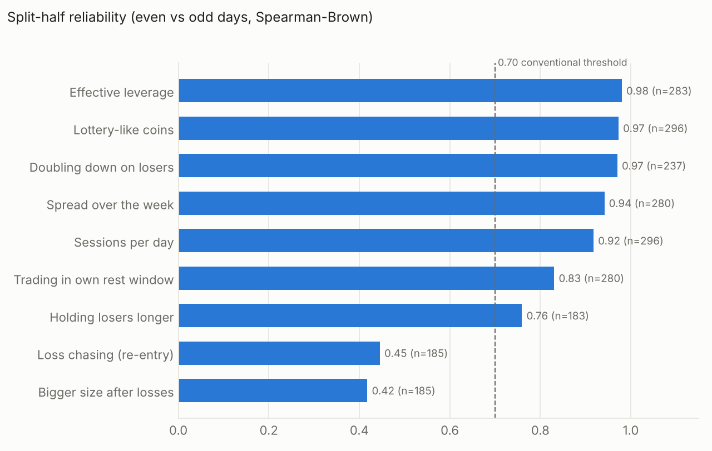
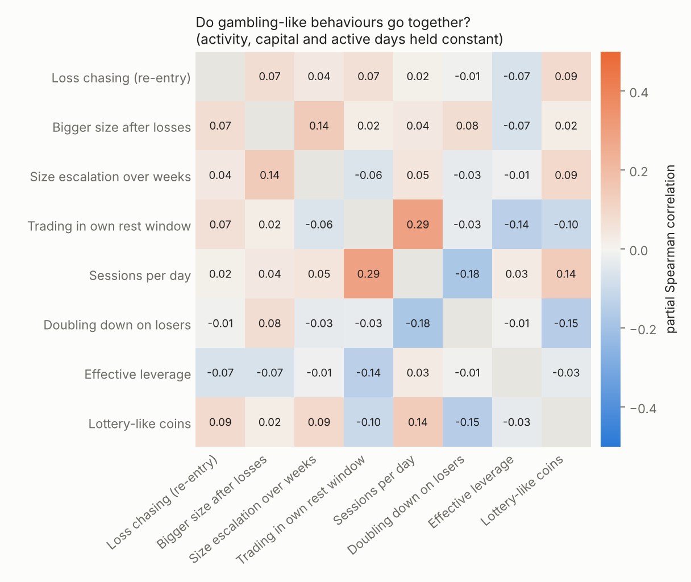
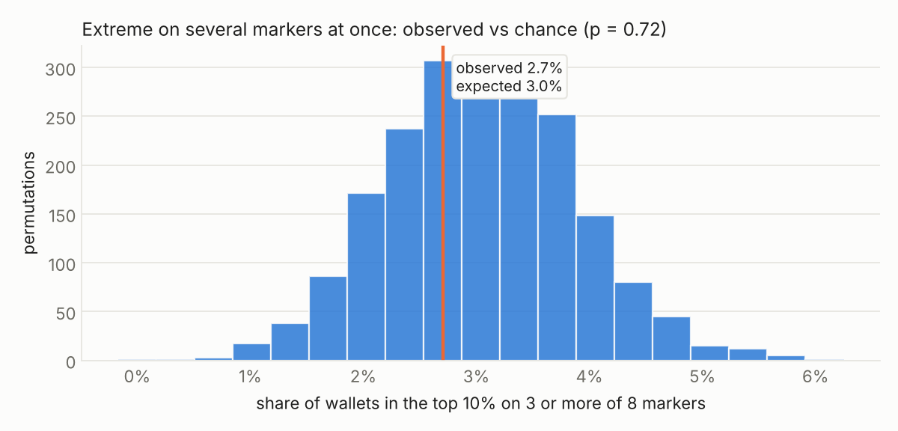
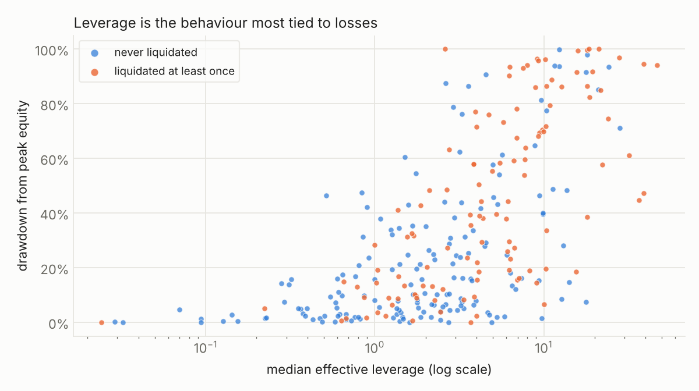

# Pilot results (November 2026)

Generated by `hyperbehave paper` (v0.4) from 429 wallets sampled from the Hyperliquid public trade stream; 90 days of trading each, downloaded 29 October and 3 November 2026. Aggregates only.

## 1. Sample

Wallets analysed: 429. Included after exclusions: 296.

| reason | n_wallets |
| --- | --- |
| fewer than 50 fills | 77 |
| market-maker pattern | 34 |
| machine-speed orders | 17 |
| market-maker pattern; machine-speed orders | 4 |
| machine-speed orders; active in almost every hour of a typical week | 1 |

Balance model of included wallets: perp+spot 282 (95%), failed 12 (4%), perp 2 (1%).

## 2. How common is each behaviour?

| behaviour | wallets | of | share | ci | vs_chance_p |
| --- | --- | --- | --- | --- | --- |
| Liquidated at least once | 122 | 296 | 41.2% | 35.8% to 46.9% |  |
| Re-deposited within 24 h of a liquidation (liquidated wallets) | 50 | 122 | 41.0% | 32.7% to 49.9% |  |
| Net trading loss over the window | 200 | 296 | 67.6% | 62.0% to 72.6% |  |
| Lost at least half of capital at risk | 53 | 284 | 18.7% | 14.6% to 23.6% |  |
| Fell at least 50% from peak equity | 71 | 284 | 25.0% | 20.3% to 30.3% |  |
| Loss chasing beyond chance (p < 0.05) | 33 | 249 | 13.3% | 9.6% to 18.0% | <0.001 |
| Bigger positions after losses beyond chance (p < 0.05) | 28 | 249 | 11.2% | 7.9% to 15.8% | <0.001 |
| Added to losing positions in at least half of trips | 70 | 272 | 25.7% | 20.9% to 31.2% |  |
| Median effective leverage of 10x or more | 43 | 284 | 15.1% | 11.4% to 19.8% |  |
| Half or more of volume in lottery-like coins | 76 | 296 | 25.7% | 21.0% to 30.9% |  |
| 10% or more of new positions in own rest window | 60 | 295 | 20.3% | 16.1% to 25.3% |  |
| Holds losers longer than winners | 77 | 243 | 31.7% | 26.2% to 37.8% |  |

## 3. Are the markers reliable?

| label | n | split_half_r | spearman_brown |
| --- | --- | --- | --- |
| Loss chasing (re-entry) | 185 | 0.29 | 0.45 |
| Bigger size after losses | 185 | 0.26 | 0.42 |
| Doubling down on losers | 237 | 0.94 | 0.97 |
| Holding losers longer | 183 | 0.61 | 0.76 |
| Trading in own rest window | 280 | 0.71 | 0.83 |
| Spread over the week | 280 | 0.89 | 0.94 |
| Sessions per day | 296 | 0.85 | 0.92 |
| Effective leverage | 283 | 0.96 | 0.98 |
| Lottery-like coins | 296 | 0.95 | 0.97 |

## 4. Do gambling-like behaviours go together?

Mean pairwise Spearman correlation: 0.012; with activity, capital and active days held constant: 0.010.

Wallets in the top 10% on 3 or more of 8 markers: observed 2.7%, expected by chance 3.0% (95% range 1.4% to 4.7%; permutation p = 0.723).

## 5. Are the behaviours linked to financial harm?

Spearman correlations; q = Benjamini-Hochberg adjusted p-value within each outcome.

| marker | drawdown rho | q | loss/capital rho | q  | liquidated rho | q   |
| --- | --- | --- | --- | --- | --- | --- |
| Loss chasing (re-entry) | -0.01 | 0.892 | -0.10 | 0.241 | -0.12 | 0.116 |
| Bigger size after losses | -0.01 | 0.892 | +0.03 | 0.778 | +0.00 | 0.961 |
| Size escalation over weeks | -0.09 | 0.353 | -0.09 | 0.388 | +0.01 | 0.961 |
| Trading in own rest window | -0.17 | 0.013 | -0.15 | 0.038 | -0.15 | 0.036 |
| Sessions per day | -0.08 | 0.353 | +0.02 | 0.778 | -0.09 | 0.235 |
| Doubling down on losers | -0.20 | 0.006 | -0.22 | 0.002 | -0.02 | 0.961 |
| Effective leverage | +0.66 | <0.001 | +0.50 | <0.001 | +0.36 | <0.001 |
| Lottery-like coins | -0.15 | 0.026 | -0.12 | 0.132 | +0.15 | 0.036 |
| Re-deposit after liquidation | -0.08 | 0.571 | +0.02 | 0.826 |  |  |
| Holding losers longer | +0.05 | 0.571 | +0.03 | 0.778 | +0.08 | 0.365 |

Composite score (mean percentile rank of the behavioural markers) in a regression with log activity, log capital and log active days as controls (HC3 robust standard errors):

| score | outcome | n | coef | se | p |
| --- | --- | --- | --- | --- | --- |
| with leverage | Drawdown from peak | 284 | 0.273 | 0.158 | 0.084 |
| with leverage | Loss / capital | 284 | 0.195 | 0.167 | 0.244 |
| with leverage | Liquidated | 296 | 0.431 | 0.239 | 0.071 |
| without leverage | Drawdown from peak | 284 | -0.288 | 0.142 | 0.042 |
| without leverage | Loss / capital | 284 | -0.302 | 0.149 | 0.042 |
| without leverage | Liquidated | 296 | -0.082 | 0.215 | 0.701 |

